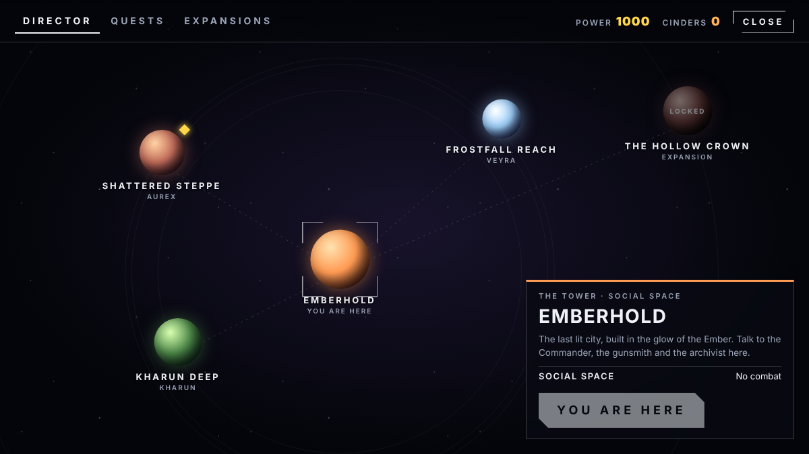

# Ember Drift

An original sci-fi looter shooter that runs in the browser, built mobile-first with Three.js. It's a personal project inspired by the feel of games like Destiny. Every name, model and line of dialogue is original.

**Play:** https://1nullvoid1.github.io/ember-drift/

## What's in it
- Four classes (Seer, Outrider, Bulwark and Screeb), each with its own save, picked from a character select screen
- An orbit screen, a character screen where your character shows off her equipped gun, and a subclass screen for supers, abilities, aspects and shards
- **Emberhold**, a social hub where you talk to Commander Rho Kestrel, Tessa Morrow the gunsmith and Old Fen the archivist
- **The Director**, a galaxy map for travelling to the Shattered Steppe, Frostfall Reach and Kharun Deep, with tabs for the rewards pass, a local map, quests and the store
- A battle world with jets you can fly with mouse aim or direct stick
- A quest system with a three-chapter story (placeholder for now) and a repeatable bounty
- Eight weapon types with perks, exotics, armor stats and two subclasses (Cinder and Tempest)
- A hooded ritualist player character with full first-person arm animations
- Touch controls, keyboard and mouse, and gamepad support with a remap screen
- An expansion framework, with **The Hollow Crown** as the first planned DLC

## Controls
| | Keyboard | Controller | Phone |
|---|---|---|---|
| Move / look | WASD + mouse | Sticks | Left thumb / right thumb |
| Fire / aim | Left / right click | RT / LT | Fire / Aim |
| Talk | E | X | Talk |
| Director | M | D-pad up | Map |
| Gear | I | View | Gear |

## Project layout
- `index.html` is the whole game in one file, with the models embedded in it
- `models/` holds the source 3D models and the Blender scripts used to rig them
- `screenshots/` holds images of the game
